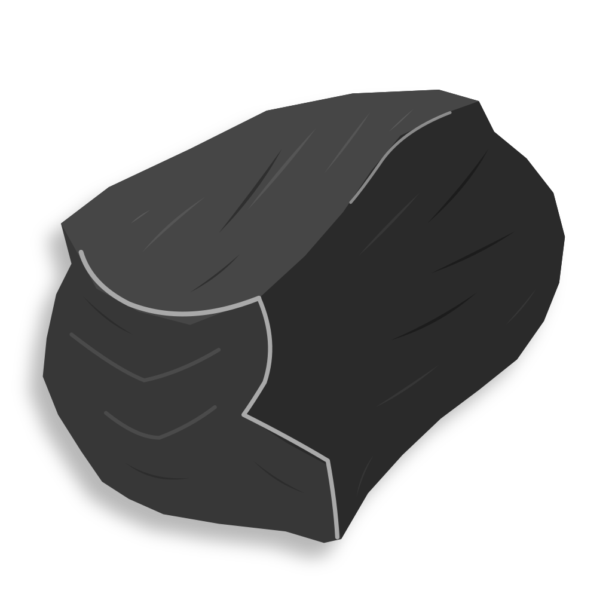
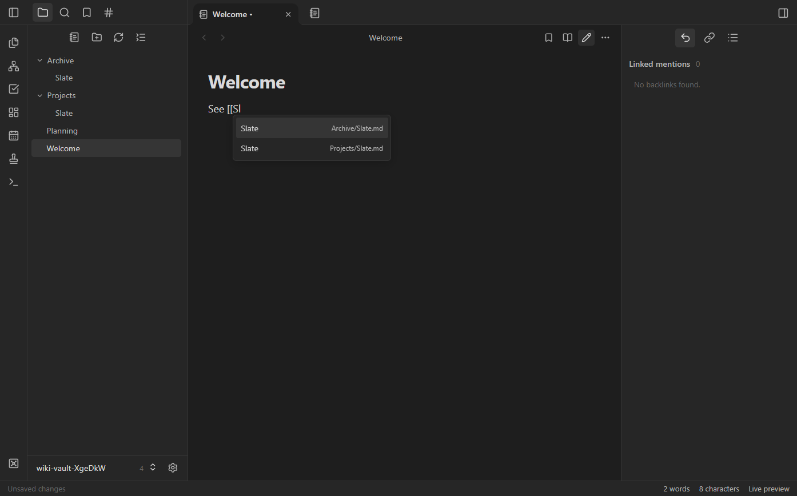
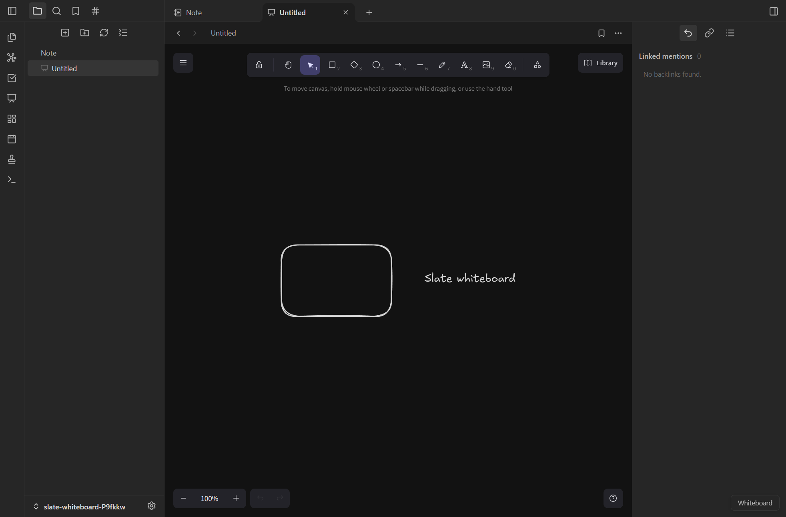
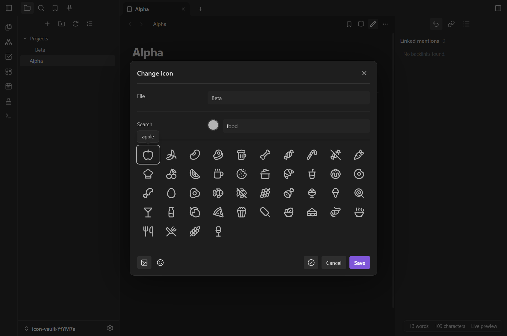
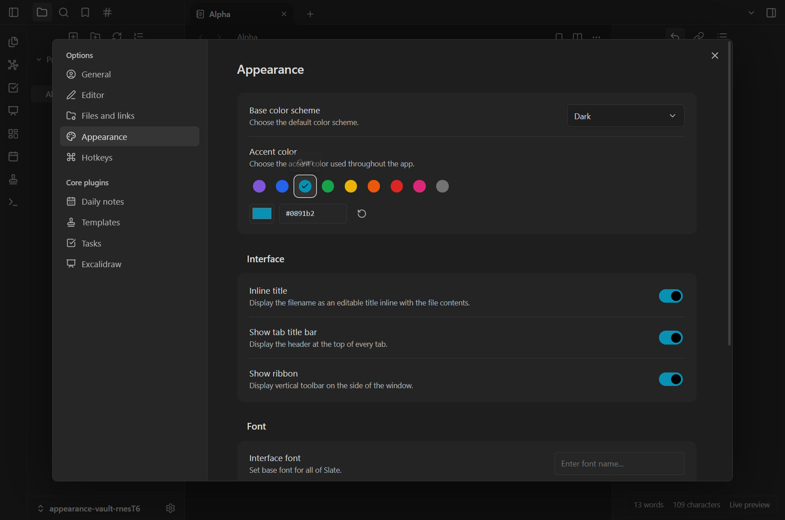

<p align="center">
  
</p>

<h1 align="center">Slate</h1>

<p align="center">
  <strong>The corporate-friendly note-taking app.</strong><br>
  Notes, tasks, and whiteboards. Local files, no cloud account, no telemetry.
</p>

<p align="center">
  <a href="https://github.com/Ganzuelo/slate/releases/download/v0.1.0/Slate-0.1.0-portable-x64.exe"><strong>Download for Windows (x64)</strong></a>
  · <a href="https://github.com/Ganzuelo/slate/releases/tag/v0.1.0">Release notes and checksum</a>
</p>

<p align="center">
  
  
  <a href="LICENSE"></a>
  
</p>

<p align="center">
  
</p>

---

## Why Slate?

Work notes belong under your control. Slate brings notes, tasks, and whiteboards together in a local-first desktop app, with no cloud account, telemetry, or third-party plugin runtime. It's built for work environments where keeping data local and limiting external dependencies matter.

Open a folder of Markdown files (a vault) and start writing in a keyboard-friendly editor. Your notes and boards stay as `.md`, `.canvas`, and `.excalidraw` files on your disk, so you can keep using your existing storage and backup tools. Runtime assets are bundled locally, and Slate doesn't download remote content.

## Features

### ✍️ Writing and linking
- **Live preview, reading view, and split preview**, built on CodeMirror 6, with code-block highlighting.
- **`[[Wiki links]]`** with autocomplete, aliases (`[[path/to/note|alias]]`), backlinks, and outgoing links.
- **Rename and move with link updates**: resolved wiki links are rewritten automatically.
- **Tabs** with pinning, history navigation, and bulk close actions.
- **Outline, word and character count, properties, and an inline editable title.**
- **Daily notes, templates, random note, quick switcher, and a command palette.**

### 🕸️ Graph view
- Force-directed **global and local graphs** of your notes: linked notes cluster, orphans ring the outside.
- Zoom toward the cursor, drag to pan, and labels appear as you zoom in.
- Graph settings filter tags, attachments, and incoming or outgoing links, and can show arrows.

### ✅ Tasks
A Markdown-first task system compatible with the Obsidian Tasks emoji format.
- Due, scheduled, start, created, and done dates; six priority levels.
- **Recurring tasks** (`every weekday`, `every month on the last`, `every 2 weeks when done`, …).
- **Fenced `tasks` queries** with filters, boolean logic, sorting, grouping, and limits, rendered live in your notes.
- Dedicated Tasks view (Today, Upcoming, Overdue) and `Ctrl+Enter` to toggle the task at the cursor.

See [TASKS.md](TASKS.md) for the full syntax.

### Dataview
- Built-in [Obsidian Dataview](https://github.com/blacksmithgu/obsidian-dataview) DQL engine for tables, lists, tasks, calendar date tables, and inline expressions.
- Queries read YAML frontmatter, inline fields, tags, links, and file metadata in reading view and live preview.
- Optional DataviewJS data queries run in isolated workers with read-only note snapshots, network blocking, and time limits.

See [DATAVIEW.md](DATAVIEW.md) for examples and compatibility limits.

### 🎨 Whiteboards and canvas


- **Excalidraw whiteboards** saved as `.excalidraw` files in your vault, with PNG export, theme sync, and autosave. The whole editor is bundled locally, including fonts.
- **Canvas** boards (`.canvas`) of connected cards.

See [research/WHITEBOARDS.md](research/WHITEBOARDS.md).

### 🏷️ Icons and emoji for files and folders


- Assign any **Lucide icon** in one of nine colors, or any of **3,944 Unicode emoji**, to files, folders, and tabs.
- Right-click → **Change icon**, or `Ctrl/Cmd+Shift+J` for the current file.
- Assignments follow renames and moves, and are stored in the vault's `.slate-icons.json`.

### 🗂️ File management
- Nested folder explorer with **pinned notes and folders**, bookmarks, and full-text and filename search.
- Context menus throughout: copy, move, rename, recoverable trash, copy link or path, and reveal in Explorer.
- **Multiple vaults**: switch between them from the vault menu in the footer.
- **File recovery**: earlier versions are kept in `.slate-history` before every overwrite.

### 🎛️ Appearance


- Light and dark themes, with a **custom accent color** from presets, a color picker, or a hex value.
- Interface and text fonts, readable line length, and toggles for the ribbon and tab title bar.
- Reorderable ribbon and a consistent [Lucide](https://lucide.dev) icon set.

## Getting started

### Windows portable app

Download the [Windows x64 portable EXE](https://github.com/Ganzuelo/slate/releases/download/v0.1.0/Slate-0.1.0-portable-x64.exe) from the [v0.1.0 prerelease](https://github.com/Ganzuelo/slate/releases/tag/v0.1.0), then run it from a writable folder. No installation, administrator access, or separate Node.js runtime is needed. The first launch extracts the bundled runtime into a temporary folder, then opens Slate.

Settings and the starter vault are saved in **`Slate Data` beside the EXE**. Keep that folder with the executable when moving Slate to another computer. Vaults you open elsewhere stay in their original locations. Avoid running two copies against the same vault at once.

This is an early, unsigned Windows x64 build; Windows may display an unknown-publisher warning. The release includes a SHA-256 checksum for verifying your download.

To build the EXE from this repository, follow the source setup below, then run `npm run build:portable`. The executable and a SHA-256 checksum are written to `dist/`.

### Run from source

**Requirements:** [Node.js](https://nodejs.org) 22 or newer. Slate is currently developed and tested on Windows.

```sh
git clone https://github.com/Ganzuelo/slate.git
cd slate
npm install
npm start
```

On Windows you can also double-click **`Start Slate.cmd`**. On first launch, choose a folder to use as your vault, or try the included [`sample-vault`](sample-vault).

> [!TIP]
> If you're trying Slate on an existing vault, start with a **copy**. Slate ignores hidden folders such as `.obsidian` and never modifies them.

### Browser mode

Slate can also run as a local web app in your default browser:

```sh
npm run browser
# or point it at a specific folder:
node server.mjs --open --vault "C:\path\to\vault"
```

## Privacy and security

Slate is designed to keep your notes on your machine:

- The vault server binds only to `127.0.0.1` on a random port. Each launch uses a random access token, and requests are checked for Host and Origin.
- The Electron window is sandboxed with Node integration disabled. The preload bridge exposes only a small set of validated actions.
- A strict CSP blocks remote resources. Note HTML is escaped, and Excalidraw web embeds are never loaded.
- Path validation rejects traversal, symlinks and junctions, hidden components, and Windows device names.
- Saves are revision-checked to detect conflicts with external editors, and are written through a flushed temporary file.
- **No** cloud sync, telemetry, auto-updates, or plugin runtime.

Details: [desktop/README.md](desktop/README.md).

## Development

| Command | Purpose |
| --- | --- |
| `npm start` | Launch the desktop app |
| `npm run browser` | Run in browser mode |
| `npm test` / `node --test` | Run the test suite |
| `npm run build:editor` | Rebuild the CodeMirror editor bundle |
| `npm run build:dataview` | Rebuild the Dataview worker and license notices |
| `npm run build:icons` | Rebuild the Lucide icon bundle |
| `npm run build:whiteboard` | Rebuild the Excalidraw bundle and license notices |
| `npm run build:app-icon` | Regenerate the app icon PNGs and `.ico` |
| `npm run build:portable` | Build the Windows x64 portable EXE and SHA-256 checksum in `dist/` |
| `npm run verify:portable` | Launch the portable EXE twice with disposable data and verify saving and persistence |
| `npm run capture:readme` | Re-capture the README hero screenshot from a disposable showcase vault |

Generated bundles in `public/vendor/` are checked in, so a rebuild is only needed after changing their sources or dependencies. UI changes should follow [DESIGN.md](DESIGN.md).

### Project layout

```
desktop/        Electron main process, preload, vault registry, app icons
public/         Renderer UI (vanilla JS + CSS) and bundled vendor assets
scripts/        Build scripts, verification harnesses, license notices
test/           node:test suites
core.mjs        Vault indexing, path validation, Markdown rendering
server.mjs      Authenticated loopback vault server
sample-vault/   Example notes to explore
```

## Limitations

Slate is an early prototype. Not yet implemented: independent split panes, Mermaid and math rendering, Vim mode, sync, mobile clients, and a plugin API. Large-vault performance has not been benchmarked; indexing is currently capped at 10,000 notes and 32 MiB of total note text.

## License

Slate is released under the [MIT License](LICENSE). Bundled third-party components keep their own licenses, listed below.

## Acknowledgements

Slate bundles [CodeMirror](https://codemirror.net), [Excalidraw](https://excalidraw.com), [Lucide](https://lucide.dev), and Unicode emoji data. Their license notices are included in [`public/vendor`](public/vendor) and [`scripts/licenses`](scripts/licenses).

Slate is an independent project and is not affiliated with or endorsed by Obsidian.
